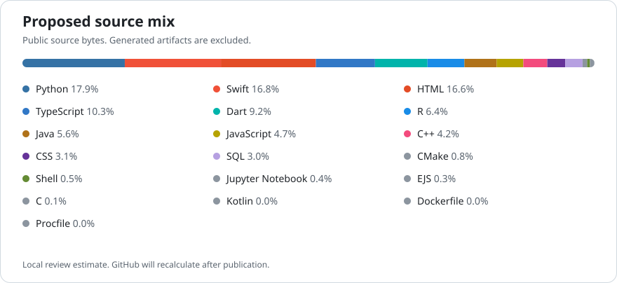

# Hi, I'm Zohaib

I build with Python, data systems, and web technologies. Previously a software engineering intern at Uber, now studying computer science at Queens College after Bucknell University.

[Portfolio](https://www.zohaibcheema.com) · [LinkedIn](https://linkedin.com/in/zohaibsafdarcheema) · [Email](mailto:zscheema9@gmail.com)

## Projects

<table>
<tr><td width="50%" valign="top">
<h3><a href="https://github.com/zohaib-cheema/DeFacto">DeFacto</a></h3>

Reproducible classification experiments with input validation, measured model evaluation, a SQL experiment store, and reports you can inspect.

<strong>Python · Pandas · Scikit learn · SQL · R</strong>

CSV exports connect the recorded results to Tableau and Power BI.

</td><td width="50%" valign="top">
<h3><a href="https://github.com/zohaib-cheema/AwareNest">AwareNest</a></h3>

A private mood journal with a companion web dashboard, account isolation, weekly trends, and Python tools for migration and exports.

<strong>React · TypeScript · Node.js · PostgreSQL · Python · Flutter</strong>

</td></tr>
<tr><td valign="top">
<h3><a href="https://github.com/zohaib-cheema/CSCI-331-Database-Systems">Database Systems</a></h3>

SQL query optimization, indexing experiments, execution plan analysis, and Python database automation. The case study includes its raw results and measurement limits.

<strong>Python · SQL · MySQL</strong>

</td><td valign="top">
<h3><a href="https://github.com/zohaib-cheema/PayPie">PayPie</a></h3>

An expense splitting project built with Next.js, TypeScript, and Firebase.

<strong>TypeScript · JavaScript · Next.js · Firebase</strong>

</td></tr>
<tr><td valign="top">
<h3><a href="https://github.com/zohaib-cheema/Voluntr">Voluntr</a></h3>

A Swift mobile prototype for discovering and organizing local volunteering opportunities.

<strong>Swift</strong>

</td><td valign="top">
<h3>Programming foundations</h3>

<a href="https://github.com/zohaib-cheema/Zork-Java">Zork in Java</a> and <a href="https://github.com/zohaib-cheema/Tree-Set-Cplus">tree structures in C++</a>.

<strong>Java · C++</strong>

</td></tr>
</table>

## Languages across my public work

The graphic uses public source bytes, with generated assignment reports classified separately. The audit script and its method are available in this repository.

How this profile is maintained

Project descriptions link to implementations. The language graphic can be regenerated from GitHub's language API. Local review estimates are labeled before publication.

The tools also render local activity or an explicitly illustrative calendar for video planning. They do not create commits or alter Git history.

